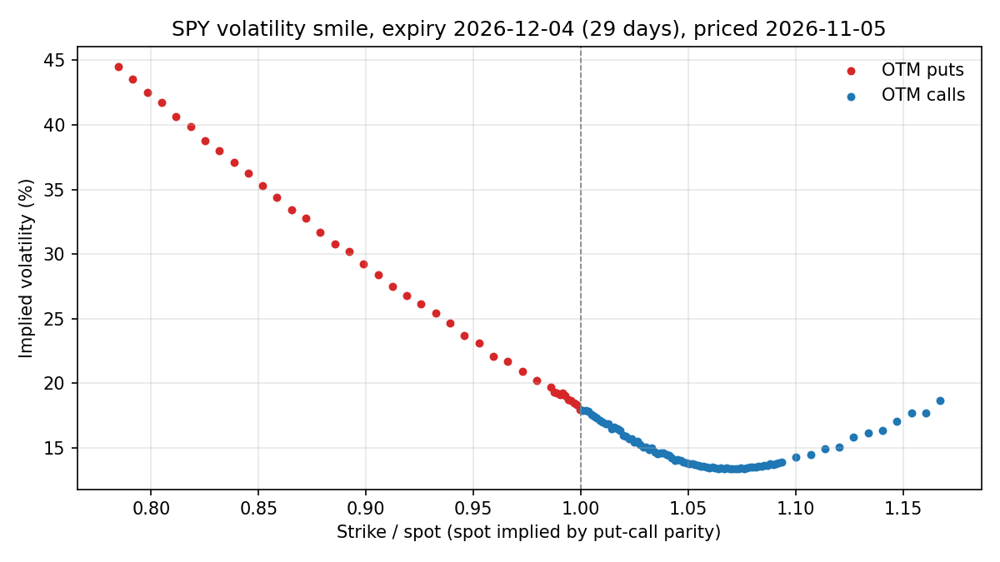

# Options pricing toolkit

Three ways to price a European option that should agree, Greeks two ways that should agree,
an implied-vol solver, and a volatility smile backed out of real SPY quotes.



## What's here

| File | What it does |
|---|---|
| `pricing.py` | Black–Scholes, Cox–Ross–Rubinstein binomial tree (European + American), Monte Carlo (antithetic variates, returns a standard error), analytic Greeks, finite-difference Greeks, implied vol (Brent's method) |
| `test_pricing.py` | The sanity checks below, as tests |
| `smile.py` | Pulls a live SPY option chain with `yfinance`, backs out implied vols, plots the smile |

```bash
pip install -r requirements.txt
python -m pytest -q        # 26 checks
python smile.py SPY 30     # ticker, target days to expiry -> smile.png, smile_data.csv
```

## Sanity checks (all in `test_pricing.py`)

- **The three pricers agree.** Binomial (2,000 steps) within 1¢ of Black–Scholes; Monte Carlo within 4 standard errors.
- **Put–call parity:** `C − P = S·e^(−qT) − K·e^(−rT)` to 1e-10.
- **No-arbitrage bounds:** `max(S·e^(−qT) − K·e^(−rT), 0) ≤ C ≤ S·e^(−qT)`, and the same for puts; an American put is worth at least the European put and at least immediate exercise.
- **Binomial → Black–Scholes:** the error shrinks about like 1/n as steps go 25 → 1,600 (CRR oscillates, so the test compares the ends, not every step).
- **Greeks:** analytic delta, gamma, vega and theta match central finite differences to 1e-4 relative.
- **Implied vol round-trips:** price at σ, solve back, get σ to 1e-7. Prices outside the no-arbitrage bounds return `nan` instead of a made-up vol.

## One thing the real data taught me

The first version of the smile had a **6-vol-point jump at the money**: puts and calls at the same strike disagreed, which put–call parity says can't happen.
The bug was in my inputs, not the market. The spot from `yfinance` was out of sync with the option quotes (and I'd guessed the dividend yield).
The fix is what desks do: back the dividend-adjusted spot out of the options themselves using parity (`S·e^(−qT) = C − P + K·e^(−rT)`, median over the strikes nearest the money), then price off that.
The jump disappeared. That's in `smile.py`.

## Where Black–Scholes breaks down

The chart is the argument. Black–Scholes assumes one constant volatility, so every strike should show the same implied vol: a flat line.
Instead it's a **skew**: deep out-of-the-money puts trade at roughly 45% vol while at-the-money options trade near 18%. That shape comes from what the model leaves out:

- **Returns have fat tails and crash risk.** Log-normal returns make a 20% drop in a month almost impossible; the market prices it as plausible, and pays up for downside puts.
- **Volatility isn't constant.** It rises when prices fall (the leverage effect), which is why the skew leans left. Stochastic-vol models (Heston) and local-vol models (Dupire) exist to fit this.
- **Prices jump.** Earnings, macro news and gaps aren't continuous diffusion, and you can't delta-hedge through a jump, so the "riskless hedge" argument behind the formula fails.
- **Trading isn't free or continuous.** Real hedging is discrete and costs a spread, so a replicating portfolio leaks money.
- **Smaller points:** rates and dividends aren't constant, and SPY options are American, though for out-of-the-money options with small dividends the early-exercise premium is tiny.

So in practice, Black–Scholes is used less as a model of the world and more as a **quoting convention**: traders quote implied vol, and the smile is how the market patches the model.
